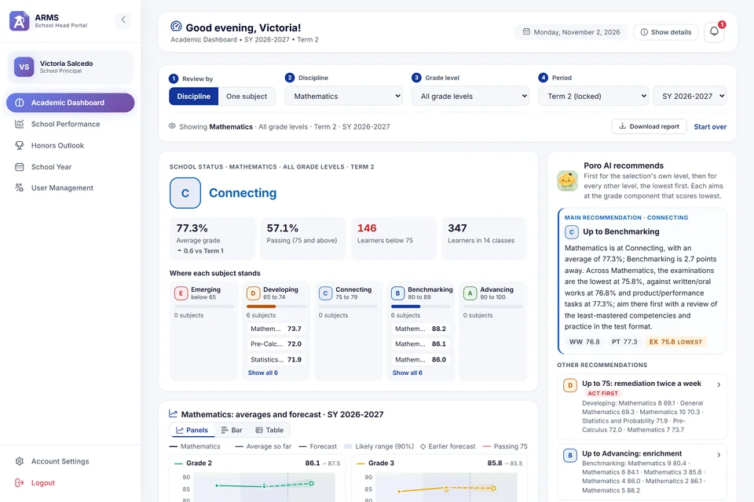
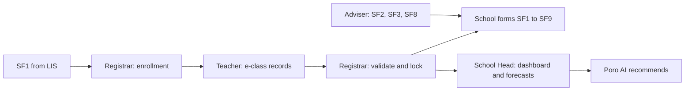
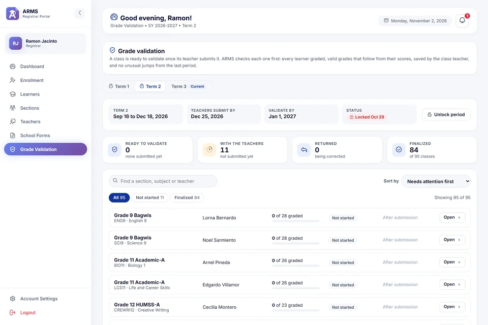
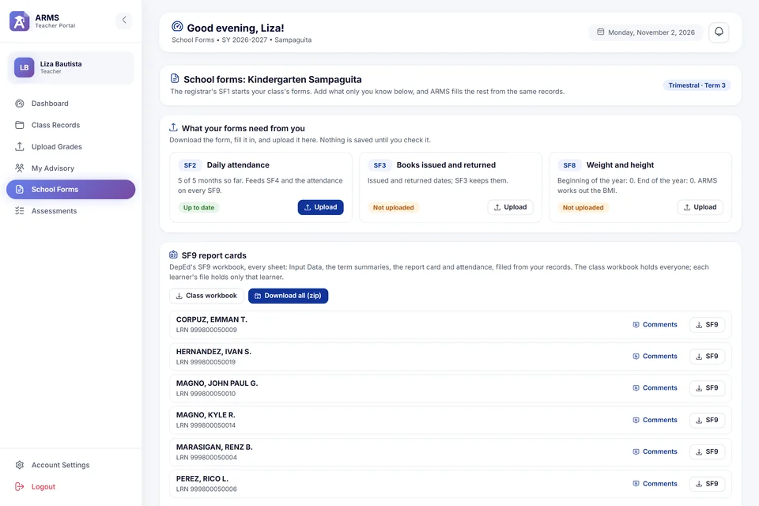

<p align="center">
  
</p>

<h1 align="center">ARMS</h1>

<p align="center">
  <b>AI-Enabled Academic Records Management System with Predictive Analytics and School Performance Prediction for Private Secondary Schools</b>
</p>

<p align="center">
  <a href="https://arms-edu.vercel.app">Live site</a> &middot;
  <a href="#what-each-portal-does">Portals</a> &middot;
  <a href="#forecasts-and-poro-ai">Forecasts and Poro AI</a> &middot;
  <a href="#getting-started">Getting started</a>
</p>

<p align="center">
  
  
  
  
  
</p>

---

ARMS keeps the academic records of a private secondary school in one place, Junior High and Senior High (and Kindergarten to Grade 6 where the school has them), and fills DepEd's own school forms from them. A learner is entered once, from the SF1. Teachers upload their e-class records, ARMS recomputes every grade the way DepEd's record does, the registrar validates and locks each grading period, and the forms SF1 to SF9 come out of the same records. The School Head sees where the school stands, where it is heading, and what to do next.

Each school follows DepEd Order No. 8, s. 2015 or DepEd Order No. 015, s. 2026, graded by quarter or by the three terms of SY 2026-2027. The partner school is Northern Paramedical & Technological College of Panabo, Inc. (NPTCI). ARMS is a capstone project of the Institute of Computing, Davao del Norte State College (DNSC).

<p align="center">
  
</p>

## Contents

- [Highlights](#highlights)
- [How the records flow](#how-the-records-flow)
- [What each portal does](#what-each-portal-does)
- [Forecasts and Poro AI](#forecasts-and-poro-ai)
- [DepEd basis](#deped-basis)
- [Tech stack](#tech-stack)
- [Getting started](#getting-started)
- [Configuration](#configuration)
- [Deploying on Vercel](#deploying-on-vercel)
- [Project layout](#project-layout)
- [Acknowledgements](#acknowledgements)

## Highlights

- **Enter it once.** The registrar enrolls a section from DepEd's SF1, exported from LIS. Everything after it reads the same records: no learner is typed twice.
- **Grades computed exactly.** ARMS reads DepEd's e-class records, quarterly or three-term, and recomputes every grade from the raw scores before anything is saved.
- **DepEd's own forms.** SF1 to SF9 are filled on DepEd's templates, with their formulas, dropdowns and print setup kept. SF9 is DepEd's full workbook, one file per learner or the whole class.
- **A forecast for every class.** An XGBoost model forecasts the next grading periods, with a likely range, for every discipline, grade level and section.
- **Recommendations a School Head can act on.** Rules decide what to do for each level of the school's DepEd order; Poro AI, a local language model, writes the classroom advice, and every word is checked before it is shown.
- **Any private school.** Each school keeps its own staff, learners, grading rules, header and logo.

## How the records flow



## What each portal does

Each signed-in role has its own portal: School Head, Registrar and Teacher.

### School Head

- **Academic Dashboard.** One overall status for the selection on the five descriptors of the school's DepEd order (Emerging to Advancing, or Did Not Meet Expectations to Outstanding). The selection can be one discipline, every discipline or one subject; one grade level, a whole stage, or every grade level; one grading period or the school year so far. The page shows where each discipline (or subject, or section) stands on the five levels, and a forecast chart.
- **Forecast chart.** It opens on the overall line. The Show list picks one discipline, grade level or section to see against it, or every one together in the same chart. A legend above the chart names every line, mark and shaded level band; Line, Bar and Table views show the same numbers three ways.
- **Poro AI recommends.** A main recommendation for the selection's own level, then one for every other level, the lowest first: keep the top level there, lift each passing level one level up, and bring a failing level up with remediation. Each is short and has no numbers, since the dashboard shows them, and aims at the grade component the classes score lowest in. See [Forecasts and Poro AI](#forecasts-and-poro-ai).
- **School Performance.** The promotion outlook if the year ended now, the forecast by grade level, each grade level's outlook, honors and attendance, enrollment over the years, and a comparison with the same period last school year.
- **Honors Outlook.** Who is on track for an academic award now and with the forecasts, who is within two points of one, and who is held back by a single final grade. Every list downloads as Excel.
- **School Year.** Start a school year with its grading system (four quarters, the three terms of DepEd Order No. 009, s. 2026, or two semesters) and its grading periods, review the choices before they are saved, make it current, and adjust period dates. The school also chooses its DepEd grading rules here.
- **User Management.** The School Head can make a trusted registrar or teacher an account manager, who can edit details, reset passwords and activate or deactivate the school's accounts from their own portal, but never the School Head's.
- **Excel reports** of the dashboard, School Performance and Honors Outlook.

### Registrar



- **Enrollment** from DepEd's SF1 (Grades 7 to 12), with a review of every learner before anything is saved. Uploading the same file twice creates nothing twice.
- **Teachers** in one go from the school's SF7, the ARMS teacher template or a CSV. Each teacher's sign-in is made from their name and the school's email domain.
- **Grade Validation.** Automatic checks before validating (every learner has a grade, every grade follows from its scores, it came from the class teacher, nothing jumped unusually), then validate, return or lock. Locking a period makes the next one current.
- **Learners.** Every learner with search by name or LRN, filters, and each learner's record, report card and movement.
- **School Forms** SF1 to SF9 on DepEd's templates, with the header each form prints (region, division, district, logo) and which sections are behind on their uploads.

Every upload page shows a picture of the expected file with the parts ARMS reads numbered.

<br clear="right">

### Teacher



- **Class Records and Upload Grades.** DepEd's e-class records for four quarters, the three-term records of DepEd Order No. 015, s. 2026 (core learning areas, GMRC and Values Education, MAPEH, EPP/TLE), and the Strengthened Senior High School record. Each class's record downloads with its learners and LRNs filled in, and every upload is reviewed before it is saved.
- **School Forms** for advisers: upload SF2 (attendance), SF3 (books) and SF8 (weight and height), and download the section's forms and SF9, one file per learner or a zip of them all, with the adviser's comments.
- **My Advisory** for advisers: every subject's grades for the section, who is below 75 and where, and each learner's record for the year.
- **Assessments:** online quizzes learners join with an access code.

<br clear="right">

### Public pages

- The school's landing page, with the forms chain explained and a contact form.
- Sign-in with Remember me, optional Google sign-in, and password reset by an emailed code.
- A friendly page-not-found, where Poro looks for the page you wanted.

## Forecasts and Poro AI

### The grade forecaster

`ml_engine/forecast.py` trains an XGBoost model on every learner, subject and grading period in the database, and forecasts the next periods with a 90% likely range.

- Its forecasts appear on the dashboard, School Performance and Honors Outlook.
- It is tested on grading periods it never saw and compared with simple rules a teacher could use. On the demo data it missed by about 2.4 points on average, against about 2.7 for "same as the last grade".
- Train it with `python manage.py train_ml_models`. It retrains itself when a registrar locks a grading period, since locked grades are final. The trained files are not in git, so a fresh copy uses a damped trend until the model is trained once.

### Poro AI

What to recommend is decided in code by rules a person can check (`heads/insights.py`): which disciplines sit on which level, the step that fits each level, and the grade component to aim at. Poro AI (`heads/poro.py`) then writes the advice for the teachers in its own words, in two or three sentences of classroom ideas that fit the discipline.

- Poro is Qwen 2.5 (3B) with Poro's persona (`ml_engine/poro/Modelfile`), running on the school's own computer through [Ollama](https://ollama.com).
- Its advice is shown only after checks: no numbers or lists, at most three sentences, no level names, no other discipline, nothing about how grades moved, no promises or causes. A second reading by the model must then find it fits the decided facts. Otherwise the computed wording stays, and the School Head can switch between the two.
- Poro never decides a grade: DepEd Order No. 015, s. 2026 says AI may not determine final grades, and its drafts are validated by people.
- Poro runs where Ollama runs. On Vercel, which cannot run it, the computed wording is shown.

## DepEd basis

| Rule | Source |
|---|---|
| Grade components (Written Work, Performance Tasks, Quarterly Assessment), transmutation, passing grade of 75, remediation below 75 | DepEd Order No. 8, s. 2015 |
| Grade descriptors: Outstanding, Very Satisfactory, Satisfactory, Fairly Satisfactory, Did Not Meet Expectations | DepEd Order No. 8, s. 2015 |
| Academic honors: With Honors, With High Honors, With Highest Honors | DepEd Order No. 36, s. 2016 |
| Descriptors Advancing, Benchmarking, Connecting, Developing, Emerging, and the Academic Excellence Award | DepEd Order No. 015, s. 2026, for schools that choose it (`core/grading_policy.py`) |
| Three terms a school year (Term 1 June to September, Term 2 September to December, Term 3 January to April) | DepEd Order No. 009, s. 2026 |
| Three-term grading: written/oral works, product/performance tasks and examinations, weighed 20/50/30 (20/60/20 for MAPEH and EPP/TLE); examinations of two summative tests and a term examination (30/30/40); the adjusted transmutation table of SY 2026-2027; the final grade the average of the three term grades | DepEd Order No. 015, s. 2026 and DepEd's three-term e-class records (`grades/ecr.py`) |
| School Forms SF1 to SF9 and e-class records | DepEd's official templates (`documentation/sf_templates/`, `grades/ecr_templates/`). SF9 uses DepEd's three-term workbooks of SY 2026-2027 for Kindergarten to Grade 12, every sheet kept; `python manage.py prepare_sf9_templates` clears their sample data and repairs the formulas it lists |
| Which discipline a subject belongs to, including the TVL / TechPro specializations under TLE | The K to 12, MATATAG and Strengthened SHS curricula (`academics/subject_catalog.py`) |

DepEd's Excel templates are filled by editing their cells in place (`core/xlsx_patch.py`), so their dropdowns, formulas and print setup stay as DepEd made them. Senior High in a three-term year still uses the SSHS e-class record, because DepEd had published no three-term Senior High record when this was built. KPUP and the levels Beginning to Advanced (DepEd Order No. 73, s. 2012) are no longer used.

## Tech stack

- Python 3.12 and Django 6.0
- PostgreSQL on [Supabase](https://supabase.com). SQLite is disabled on purpose.
- XGBoost, scikit-learn, pandas and NumPy for the forecaster
- openpyxl and xlrd for Excel files
- Django templates with plain CSS and JavaScript; SVG and Chart.js charts
- Optional: Ollama for Poro AI, and Redis for a shared cache across several servers

## Getting started

1. **Install.** Use Python 3.12.

   ```bash
   git clone https://github.com/Yoko-Haren/arms-edu.git
   cd arms-edu
   python -m venv .venv
   ```

   Activate the virtual environment (Windows: `.venv\Scripts\activate`, macOS or Linux: `source .venv/bin/activate`), then install the packages:

   ```bash
   pip install -r requirements.txt
   ```

2. **Configure.** Copy `.env.example` to `.env` and fill it in (see [Configuration](#configuration)). `.env` holds your secrets and is git-ignored. Never commit it.

3. **Create the database tables.**

   ```bash
   python manage.py migrate
   ```

4. **Create the first account.**

   ```bash
   python manage.py createsuperuser
   ```

5. **Optional: load the demo schools.** `seed_demo` creates a school graded by quarter with accounts for every role. `seed_demo --trimestral` creates a three-term school under DepEd Order No. 015, s. 2026 (last year in quarters, this year in terms), and `--elementary` adds Kindergarten to Grade 6 to it. All demo accounts share the password in `DEMO_PASSWORD`. Both take `--reset`, `--remove`, `--dry-run` and `--spread-levels`.

   ```bash
   python manage.py seed_demo
   python manage.py seed_demo --trimestral
   ```

6. **Train the forecaster.** Run it again after new grades come in.

   ```bash
   python manage.py train_ml_models
   ```

7. **Run the server**, then open http://127.0.0.1:8000.

   ```bash
   python manage.py runserver
   ```

8. **Optional: Poro AI.** Install [Ollama](https://ollama.com), pull the base model (about 1.9 GB), then build `poro` from it:

   ```bash
   ollama pull qwen2.5:3b
   ```

   ```bash
   python manage.py setup_poro
   ```

## Configuration

All settings come from `.env`. The full list with examples is in `.env.example`.

| Variable | What it is |
|---|---|
| `DJANGO_SECRET_KEY` | A long random secret. Required. |
| `DJANGO_DEBUG` | `True` only on a development machine. |
| `DATABASE_URL` | The Supabase PostgreSQL connection URL. Required. |
| `SUPABASE_URL`, `SUPABASE_ANON_KEY`, `SUPABASE_SERVICE_ROLE_KEY` | The Supabase project and its keys. |
| `GOOGLE_CLIENT_ID`, `GOOGLE_CLIENT_SECRET`, `GOOGLE_REDIRECT_URI` | The Google sign-in OAuth client. The redirect URI for local use is `http://127.0.0.1:8000/accounts/google/callback/`. |
| `GOOGLE_BINDING_REQUIRED` | `False` lets users skip linking a Google account. |
| `EMAIL_HOST`, `EMAIL_PORT`, `EMAIL_USE_TLS`, `EMAIL_HOST_USER`, `EMAIL_HOST_PASSWORD`, `DEFAULT_FROM_EMAIL` | The mail account for verification codes, password-reset codes and sign-in details. For Gmail, use an App Password. |
| `ARMS_CONTACT_EMAIL` | Where contact-form messages go. |
| `DEMO_PASSWORD` | The password of the demo accounts. It is generated on the first `seed_demo` run if empty. |
| `PORO_AI_ENABLED`, `OLLAMA_URL`, `PORO_AI_MODEL`, `PORO_AI_BASE_MODEL`, `PORO_AI_WRITE_TIMEOUT` | Poro AI and its local model. `PORO_AI_ENABLED` is off by default on Vercel. |
| `PAGE_CACHE` | `False` turns the per-user page cache off while troubleshooting. |
| `REMEMBER_ME_DAYS` | How long Remember me keeps a user signed in. The default is 30. |
| `REDIS_URL` | Optional shared cache when the app runs on several servers. |
| `DJANGO_ALLOWED_HOSTS`, `DJANGO_CSRF_TRUSTED_ORIGINS` | Extra host names and origins when deployed, comma separated. |
| `VERCEL_DEPLOY_HOOK_URL` | Optional. A Vercel Deploy Hook for the main branch; on Vercel, a locked grading period asks it for a new deployment, whose build retrains the forecaster. |

## Deploying on Vercel

- The build runs `collectstatic` and trains the forecaster (`vercel.json`), so every deployment carries a fresh model.
- The whole app is one function with a 500 MB limit, mostly taken by NumPy, pandas, SciPy, scikit-learn and XGBoost. Vercel serves the collected static files from its CDN, so `vercel.json` leaves `static/`, `staticfiles/` and `design/` out of the function. Templates the code opens at run time live inside the apps (`documentation/sf_templates`, `grades/ecr_templates`).
- Set the variables above in the project's Environment Variables, with `DJANGO_DEBUG` off, and add the live address's callback to the Google OAuth client.

## Project layout

| Path | What it holds |
|---|---|
| `config/` | Settings and the main URLs |
| `accounts/` | Sign-in, Google sign-in, password reset, account settings, the `seed_demo` command |
| `heads/` | The School Head portal: dashboard, its decisions (`insights.py`) and Poro AI (`poro.py`), forecast charts (`forecasts.py`), Honors Outlook, School Performance, School Year, User Management |
| `registrars/` | The Registrar portal: enrollment, learners, sections, teachers (`teacher_import.py`), grade validation, School Forms |
| `teachers/` | The Teacher portal: class records, e-class record uploads, My Advisory, School Forms |
| `assessments/` | Online quizzes |
| `grades/`, `enrollment/`, `documentation/` | The e-class record reader, the SF1 reader, and the DepEd school forms (`school_forms.py`, the SF9 workbooks in `sf9.py`, the advisers' uploads in `form_uploads.py`) |
| `academics/`, `students/`, `attendance/`, `scheduling/`, `promotion/`, … | School structure, learners, attendance, class assignments and promotion records |
| `ml_engine/` | The grade forecaster, the `train_ml_models` command, retraining (`training.py`), and Poro's Modelfile with the `setup_poro` command |
| `communication/` | Notifications and contact requests |
| `audit/` | Activity logs and anomaly detection (`python manage.py detect_anomalies`) |
| `core/` | Shared helpers: the DepEd grading rules each school follows (`grading_policy.py`), page caching, Excel template patching, the school form header |
| `templates/`, `static/` | Pages, styles, scripts, the ARMS logo, Poro, the upload guide pictures and DepEd form templates for download |

## Acknowledgements

Built for and with **Northern Paramedical & Technological College of Panabo, Inc.**, Panabo City, Davao del Norte, as a capstone project of the **Institute of Computing, Davao del Norte State College**. The school forms and e-class records are the Department of Education's own; ARMS only fills them in.
